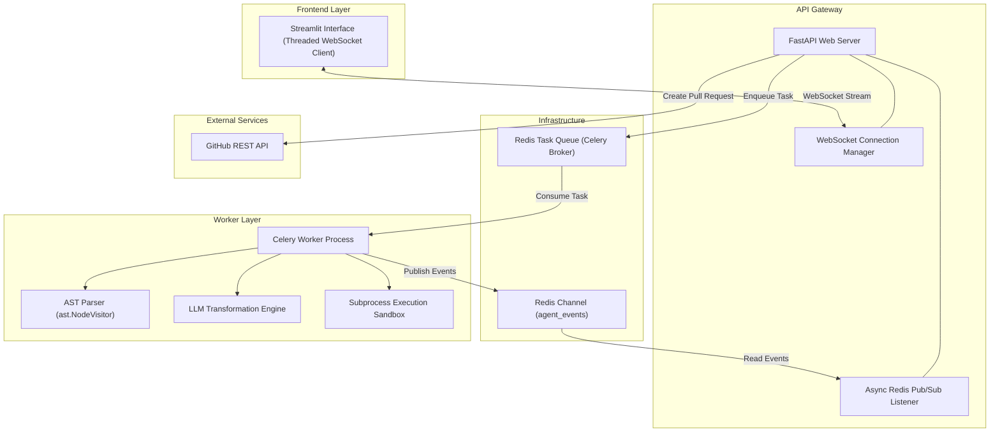
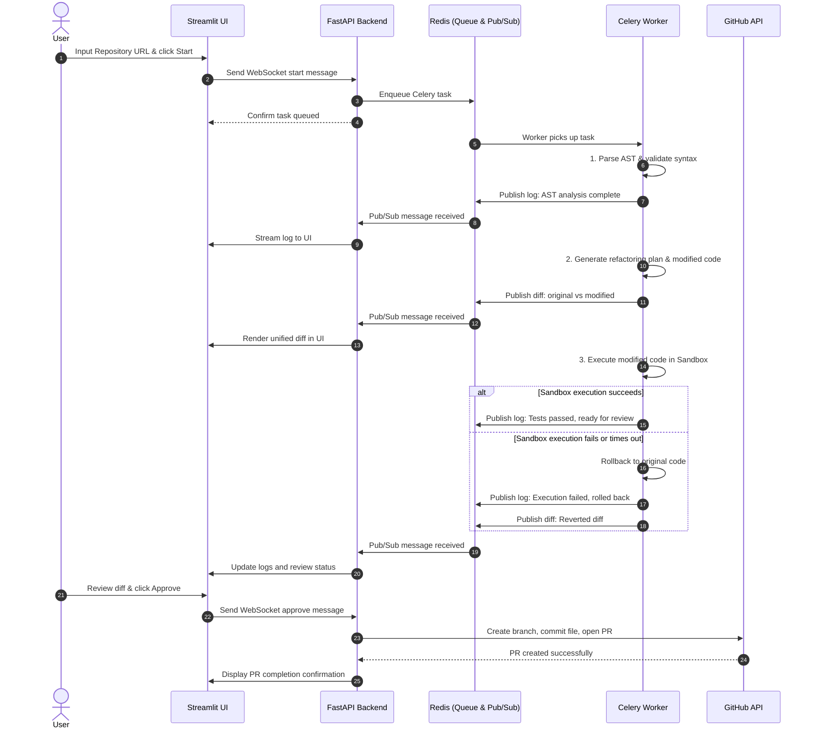

# Autonomous Refactoring Agent

An autonomous, self-healing system designed to ingest code repositories, extract syntactic structures using Abstract Syntax Tree (AST) analysis, plan and apply code transformations, validate executions inside an isolated sandbox, and stream real-time logs and diffs to users for pull request review.

---

## 1. System Overview

Refactoring legacy codebases using large language models often suffers from two primary failure modes:
1. Syntax and semantic hallucinations caused by treating code as unconstrained free-form text.
2. Silent regressions introduced when proposed edits break existing logic or introduce runtime errors.

The Autonomous Refactoring Agent mitigates these issues by combining AST-guided structure validation, sandboxed execution verification with self-healing rollbacks, and an asynchronous event-driven architecture that separates long-running computation from the user-facing web tier.

---

## 2. Architecture Diagram

The system employs a decoupled, asynchronous architecture featuring a frontend interface, an API gateway, a Redis message broker, and background workers.



---

## 3. Core Components

### 3.1 Frontend (Streamlit Client)
- File: `backend/streamlit_app.py`
- Role: Provides real-time visibility into agent execution, presenting colored log streams and unified file diffs.
- Execution Pattern: Runs a persistent background thread (`websocket.WebSocketApp`) that feeds incoming payloads into a thread-safe `queue.Queue`. The Streamlit application consumes this queue on UI refresh cycles, avoiding blocking the main rendering loop.

### 3.2 API Layer (FastAPI & WebSockets)
- Files: `backend/main.py`, `backend/ws_manager.py`
- Role: Handles incoming client WebSocket connections and serves as an event broadcaster.
- Asynchronous Listener: Utilizes FastAPI's `lifespan` context to run an asynchronous task listening to the Redis `agent_events` channel. When events arrive, it forwards them over active WebSocket connections.
- Task Offloading: Dispatches incoming refactoring requests to Celery using `execute_agent_workflow_task.delay(repo_url)`, immediately freeing the server to handle concurrent user connections.

### 3.3 Message Broker & Event Bus (Redis)
- Role: Dual-purpose infrastructure component.
  1. Task Broker: Manages the Celery queue for distributed background job scheduling.
  2. Pub/Sub Broker: Decouples the worker execution from the web server by routing log messages and file diffs through the `agent_events` topic.

### 3.4 Worker & Refactoring Pipeline (Celery)
- Files: `backend/agent/tasks.py`, `backend/celery_app.py`
- Role: Executes the end-to-end refactoring pipeline asynchronously.
- Lifecycle:
  1. Clones target repository and isolates Python source files.
  2. Traverses code structures using the AST parser to detect functions, classes, and syntax validity.
  3. Prompts the language model to generate a refactoring plan and produce updated source code.
  4. Publishes original and modified file diffs to Redis Pub/Sub.
  5. Runs the modified code inside the sandbox.
  6. If execution succeeds, marks the job ready for human review.
  7. If execution fails, initiates a self-healing rollback to restore the original source.

### 3.5 AST Parser
- File: `backend/agent/ast_parser.py`
- Role: Performs structural code analysis using Python's standard `ast` library.
- Implementation: Employs a custom `ast.NodeVisitor` (`CodeAnalyzer`) that extracts function definitions and class declarations. Provides instant syntax error detection prior to running heavier downstream tasks.

### 3.6 Sandboxed Execution Environment
- File: `backend/agent/sandbox.py`
- Role: Executes modified Python scripts within an isolated subprocess with strict execution timeouts.
- Mechanism: Writes code to temporary disk storage (`tempfile.NamedTemporaryFile`) and invokes `python3` via `subprocess.run(..., timeout=5)`. Captures return codes, standard output, and standard error streams while ensuring cleanup in a `finally` block.

### 3.7 GitHub Integration
- File: `backend/github_client.py`
- Role: Programmatically manages version control operations upon user approval.
- Mechanism: Uses `PyGithub` to create target branches, commit modified file contents, and open Pull Requests against the repository base branch.

---

## 4. Architectural Trade-offs and Design Decisions

| Decision Area | Chosen Approach | Alternative Considered | Trade-off Analysis |
|---|---|---|---|
| Code Analysis | Native AST Parsing (`ast.NodeVisitor`) | Regular Expressions / Pure LLM Parsing | AST guarantees syntactic correctness and semantic tree inspection without hallucination. It is language-specific to Python, requiring language-specific parsers (e.g., Tree-sitter) if expanding to multi-language repositories. |
| Task Processing | Celery with Redis Message Broker | FastAPI In-Process BackgroundTasks (`asyncio.create_task`) | Celery provides process isolation, persistence, horizontal scaling across multiple worker nodes, and worker restarts on crash. However, it introduces operational complexity requiring a running Redis instance and worker process supervision. |
| Real-time Telemetry | Redis Pub/Sub + WebSockets | HTTP Short/Long Polling | WebSockets combined with Redis Pub/Sub deliver immediate, push-based updates for diffs and logs with minimal network overhead. Polling would introduce latency and unnecessary database/cache read pressure. |
| Sandbox Security | Subprocess with Hard Timeout (`subprocess.run`) | Containerized Isolation (Docker / gVisor) | Subprocesses have zero cold-start overhead and require no external container daemon, making local development fast. However, they lack kernel-level filesystem and network isolation against malicious code. Production deployments should transition to Docker or Firecracker microVMs. |
| Error Recovery | Deterministic Rollback on Test Failure | Iterative LLM Multi-Turn Self-Repair | Deterministic rollback prevents infinite loops and escalating API costs when generated code cannot execute. It guarantees safety but abandons the transformation rather than attempting self-correction based on compiler/test error output. |

---

## 5. End-to-End Workflow



---

## 6. Project Structure

```
Autonomous-Refactoring-Agent/
|-- backend/
|   |-- agent/
|   |   |-- ast_parser.py       # AST parsing and syntax structure inspection
|   |   |-- llm_client.py       # LLM interface for planning and code modification
|   |   |-- sandbox.py          # Subprocess-based code runner with timeouts
|   |   |-- tasks.py            # Celery task definitions and workflow orchestration
|   |-- celery_app.py           # Celery application configuration and initialization
|   |-- github_client.py        # PyGithub integration for automated PR creation
|   |-- main.py                 # FastAPI application, WebSockets, and Redis listener
|   |-- requirements.txt        # Python dependency manifest
|   |-- start.sh                # Container and local entrypoint script
|   |-- streamlit_app.py        # Streamlit user interface with WebSocket client
|   |-- ws_manager.py           # In-memory WebSocket connection registry
|-- .env.example                # Sample environment variable template
|-- .gitignore                  # Git ignore rules
|-- LICENSE                     # License terms
`-- README.md                   # System documentation
```

---

## 7. Environment Variables

Create a `.env` file in the `backend/` directory based on `.env.example`:

| Variable | Description | Default |
|---|---|---|
| `REDIS_URL` | Redis connection URI for Celery broker and Pub/Sub | `redis://localhost:6379/0` |
| `WS_URL` | WebSocket URI consumed by the Streamlit frontend | `ws://localhost:8000/ws` |
| `LLM_API_KEY` | API authentication key for the model provider | `mock_key` |
| `GITHUB_TOKEN` | GitHub Personal Access Token with repository write permissions | (empty) |
| `PORT` | Listening port for the FastAPI server | `8000` |

---

## 8. Installation and Local Setup

### Prerequisites
- Python 3.10 or higher
- Redis (installed locally or running via Docker)

### Step 1: Start Redis
```bash
docker run -d --name redis-server -p 6379:6379 redis:alpine
```

### Step 2: Install Python Dependencies
```bash
cd backend
python -m venv venv
source venv/bin/activate
pip install -r requirements.txt
```

### Step 3: Run the FastAPI Server
```bash
uvicorn main:app --reload --port 8000
```

### Step 4: Start the Celery Worker
In a separate terminal:
```bash
cd backend
source venv/bin/activate
celery -A celery_app worker --loglevel=info
```

### Step 5: Launch the Streamlit Frontend
In a third terminal:
```bash
cd backend
source venv/bin/activate
streamlit run streamlit_app.py
```

Access the interface at `http://localhost:8501`.

---

## 9. Verification and Testing

To verify the end-to-end flow locally:
1. Ensure Redis, FastAPI, and Celery are running.
2. Open `http://localhost:8501`.
3. Provide a test repository URL in the sidebar and select **Start Refactoring Agent**.
4. Observe the streamed execution logs in the left panel.
5. Review the generated unified diff in the right panel.
6. Click **Approve & Create PR** to trigger branch creation and PR opening on GitHub.